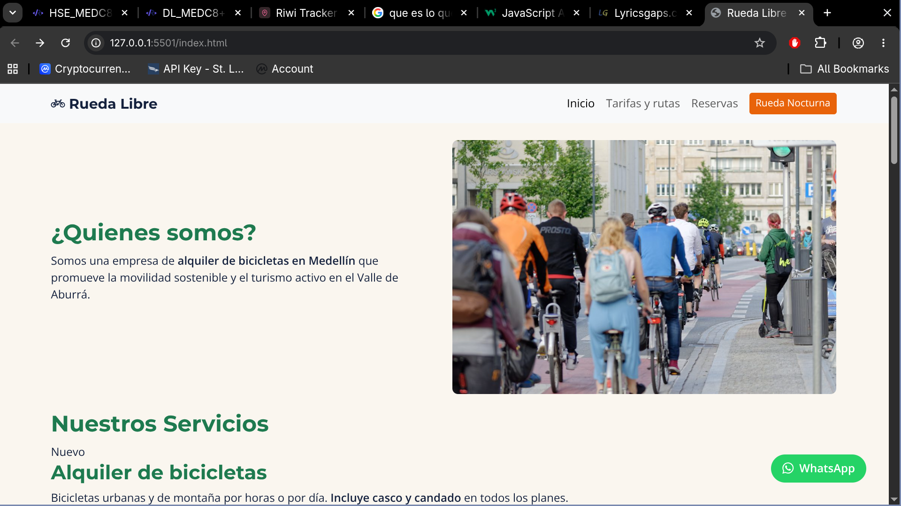
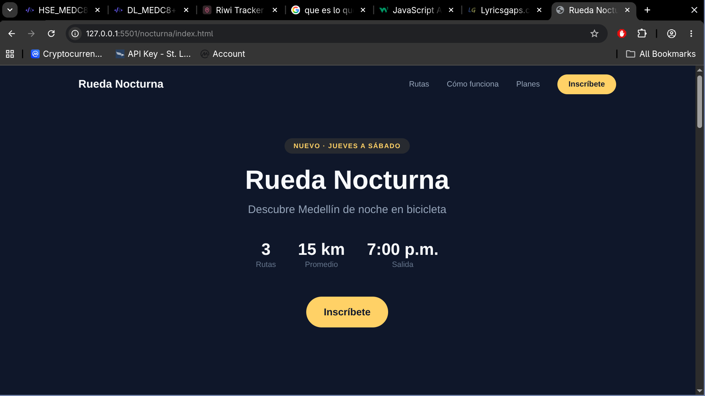
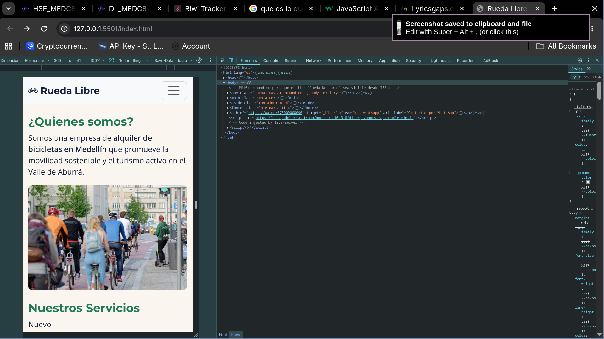
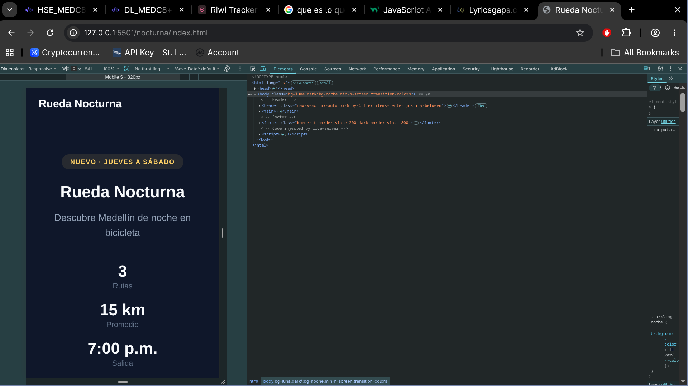

# Rueda Libre — Ecosystem v2.0

Bicycle rental and guided tour service in Medellín. Two integrated products built as part of the Riwi bootcamp HTML & CSS track:

- **Rueda Libre v2.0** — Main site built with Bootstrap 5 (homepage, pricing, reservations).
- **Rueda Nocturna** — Campaign landing page built with Tailwind CSS v4 (night tour promotion with dark mode).

## Live Demo

- **Main site:** [https://alejandrovilla06.github.io/rueda-libre/](https://alejandrovilla06.github.io/rueda-libre/)
- **Landing Nocturna:** [https://alejandrovilla06.github.io/rueda-libre/nocturna/](https://alejandrovilla06.github.io/rueda-libre/nocturna/)

## Pages

| Page | Path | Framework | Description |
|------|------|-----------|-------------|
| Homepage | `index.html` | Bootstrap 5 | Fleet carousel, services, about us |
| Pricing | `paginas/tarifas.html` | Bootstrap 5 | Rental and tour pricing tables |
| Reservations | `paginas/reservas.html` | Bootstrap 5 | Booking form with validation |
| Rueda Nocturna | `nocturna/index.html` | Tailwind CSS v4 | Night tour landing: hero, routes, steps, plans, inscription form |

## Technologies

- **HTML5** — Semantic structure (`<header>`, `<main>`, `<section>`, `<fieldset>`, `<legend>`)
- **Bootstrap 5.3** — Grid system, navbar, carousel, cards, responsive utilities
- **Tailwind CSS v4** — Utility-first classes, `@theme` tokens, `@apply` abstractions, `dark:` variant
- **CSS Custom Properties** — Brand tokens for colors and typography
- **Native form validation** — `required`, `pattern`, `minlength`, `min`/`max` attributes

## Framework Recommendation

After building with both frameworks in the same project, **Tailwind CSS** is recommended for projects that need custom branding, dark mode, and optimized CSS output. Bootstrap remains better for rapid prototyping with pre-built interactive components. Full analysis in [`nocturna/FRAMEWORK.md`](nocturna/FRAMEWORK.md).

## Screenshots

### Desktop — Main Site (Bootstrap)


### Desktop — Landing Nocturna (Tailwind + Dark Mode)


### Mobile — Main Site (360px)


### Mobile — Landing Nocturna (Dark Mode)


## Key Learnings

- **Semantic HTML** gives structure meaning beyond visual appearance — accessibility and SEO benefit directly.
- **Mobile-first design** (`grid-cols-1` → `lg:grid-cols-3`) ensures the base experience works on small screens.
- **CSS Grid vs Flexbox** — Grid for two-dimensional layouts (route cards, pricing plans), Flexbox for one-dimensional alignment (nav, card internals).
- **`@theme` tokens** centralize the brand palette so a full rebrand means editing one block.
- **`@apply`** reduces repetition only when a pattern repeats many times (buttons used 6x, inputs 4x).
- **Dark mode** with `dark:` variant follows system preference without JavaScript.
- **Native validation** (`required`, `pattern`, `minlength`) provides accessible form feedback without JavaScript.
- **Cross-framework integration** — Bootstrap and Tailwind coexist in the same repo by scoping Tailwind to its own directory with its own build.

## Project Structure

```
rueda-libre/
├── index.html              # Bootstrap homepage
├── css/style.css           # Custom CSS for Bootstrap site
├── img/                    # Shared images
├── paginas/
│   ├── reservas.html       # Reservations page
│   └── tarifas.html        # Pricing page
├── nocturna/
│   ├── index.html          # Tailwind landing page
│   ├── src/input.css       # Tailwind source with @theme
│   ├── dist/output.css     # Compiled Tailwind CSS
│   ├── FRAMEWORK.md        # Bootstrap vs Tailwind analysis
│   └── package.json        # Tailwind CLI config
├── bitacora.txt            # Development log
└── README.md
```

## Author

**Alejandro Villa** — Riwi Bootcamp, Desarrollo de Software MED (C8+)

- GitHub: [@AlejandroVilla06](https://github.com/AlejandroVilla06)
